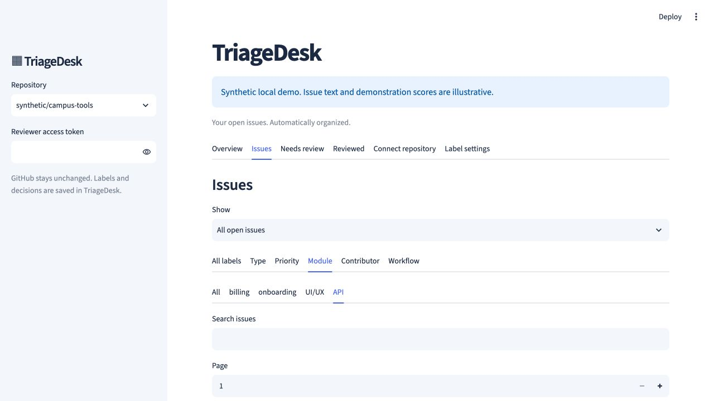
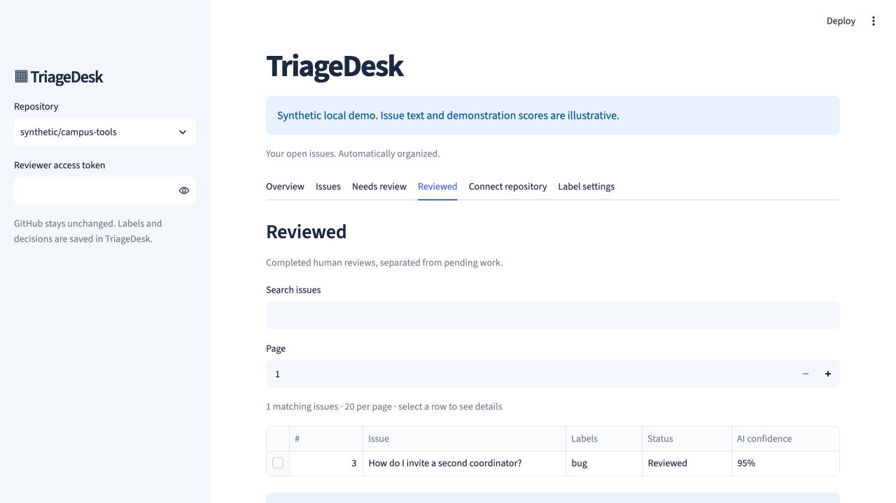

# Automatic AI labels — version 0.3

TriageDesk uses Groq's hosted API to label imported public GitHub issues. Labels are stored inside TriageDesk, as requested; this version never writes labels back to GitHub. The existing GitHub token/App permissions remain read-only.

**Key saved but still shown as missing?** Version 0.3.1 refreshes the private backend when supported secrets change and uses current setup status instead of an old import result. Follow [the secrets troubleshooting steps](SECRETS_TROUBLESHOOTING.md) to update and reboot an existing deployment.

## Enable it on your existing free deployment

1. Replace the deployed repository's source with this updated version, including `src/`, `ui/`, `alembic/`, `pyproject.toml`, and `uv.lock`.
2. Create your own key in the [Groq console](https://console.groq.com/keys). Remain on its Free plan for the temporary demo. [Free-plan FAQ](https://community.groq.com/t/do-i-get-charged-for-anything-on-the-groq-free-plan/832); [current rate limits](https://console.groq.com/docs/rate-limits).
3. In **Streamlit Community Cloud → App settings → Secrets**, keep your existing `DATABASE_URL`, `AUTH_ENCRYPTION_KEY`, and optional `GITHUB_CLIENT_ID`. Add these top-level settings:

   ```toml
   GROQ_API_KEY = "YOUR_OWN_GROQ_KEY"
   AI_MODEL = "qwen/qwen3.8-27b"
   AI_CONFIDENCE_THRESHOLD = 0.85
   AI_BATCH_SIZE = 5
   ```

4. Save, deploy/reboot, and keep the entrypoint **`ui/community_app.py`**, with **Python 3.12**. The helper passes the Groq key only to the private backend. Never commit a populated secrets file.
5. Startup applies migration **0003**. Keep your existing database and encryption key; do not reset either. This migration adds the label tables without discarding existing issues, snapshots, or human reviews.
6. Sign in and select a connected repository. The app starts checking for changes and labeling pending issues automatically. For a first connection, use **Connect repository**. No trained model artifact, GPU, or local large-model download is required.

The default Qwen model supports Groq's structured JSON output and non-thinking mode. It is currently a preview model; availability and account quotas can change. `AI_MODEL` can be changed to another model supporting strict JSON-schema responses. [Model documentation](https://console.groq.com/docs/model/qwen/qwen3.8-27b); [structured outputs](https://console.groq.com/docs/structured-outputs).

For local Docker, add the same values to the ignored `.env`, run `python3 scripts/setup-github-local.py`, then `docker compose up --build -d --wait` in the project root. Keep your selected project name/ports if you already use a separate local installation.

## What happens automatically

1. The first connection fetches the most recently updated **open** issues, excluding pull requests.
2. A background job sends each pending report's title, a bounded description excerpt, existing labels, and configured label names to Groq. GitHub credentials and application-session tokens are never included in the model input.
3. The model returns a summary, explanation, labels, exact supporting quotations, confidence scores, and an uncertainty flag. The backend rejects unknown labels, invalid scores, repeated labels, or unsupported quotations.
4. Each result is committed to PostgreSQL. The cache identity includes the source snapshot, model, prompt version, and label taxonomy. Reopening a page, logging in again, or restarting the cloud app reuses completed results.
5. Results at or above the cutoff are **Auto-sorted**, provided the model did not mark them uncertain. A result below the cutoff, with an uncertain flag, without one primary type, or based on truncated issue text goes to **Needs review**.
6. Saving a human decision moves that issue to **Reviewed** and removes it from **Needs review**. Human labels override AI labels; the original AI output and review history remain available for open issues. Previous completed reviews from version 0.2 are recognized too.
7. While the selected workspace is open, the app checks for changes approximately every **60 seconds**. Synchronization includes closure events. When a closure is observed, the issue and its dependent snapshots, predictions, AI cache, reviews, and relationship judgments are **deleted from the connected workspace database**, following the requested retention policy. Other issues remain intact. A reopened report can be imported again.

The default is **five pending reports per pass**, with spacing between requests. Remaining reports are processed in later passes. GitHub/provider backoff, an active import, network delays, or sleeping free hosting can delay processing. This is browser-driven polling with bounded background jobs, not an always-running webhook service. It cannot observe closures while the app is asleep or no workspace is open; the next refresh checks again.

The private historical import/training CLI retains its original open/closed collection behavior for reproducible experiments. The active-workspace purge is performed by authenticated connection jobs.

## Label groups and navigation

| Group | Initial labels |
|---|---|
| Type / nature | bug, enhancement, documentation, question |
| Priority / severity | priority: high, priority: medium, priority: low, regression |
| Product / module | billing, onboarding, UI/UX, API |
| Contributor level | good first issue, help wanted, easy |
| Status / workflow | waiting for op's response, dependencies, CI |

An issue has one primary type when the evidence supports it and any applicable optional labels. The model is instructed to omit unsupported optional groups. It does not assume every bug is high priority or every short report is easy. Contributor/workflow labels require supporting statements or existing labels; the app does not fetch entire comment threads to infer unstated workflow decisions.

The main navigation is now clickable tabs: **Overview**, **Issues**, **Needs review**, **Reviewed**, **Connect repository**, and **Label settings**. In **Issues**, choose a label group and then a label in the nested tabs. Select an issue row to inspect it; no separate “Inspect issue” navigation button is needed.

**Overview → How AI labeled the current issues** replaces Category signals. Its charts show the LLM's current-snapshot label distribution, including uncertain suggestions. Human changes are visible on the issue and in Reviewed. Closed reports and stale snapshots are excluded from these views.

**Label settings** lets a verified maintainer customize each repository's groups. Taxonomy changes invalidate the old classification cache for the current view; new results are generated using the new names. Previous decisions remain in history until the issue itself is purged on closure.

## Confidence and failure behavior

`AI_CONFIDENCE_THRESHOLD=0.85` is a configurable operational cutoff. It is **not a claim of 85% measured correctness**. Scores are model-reported and uncalibrated. The effective confidence is the minimum of the overall score and the selected label scores. An explicit uncertainty flag always requires review, even with a high numeric score.

Missing credentials, failed requests, exhausted quota, or invalid output leave the report **Waiting for AI**. Such cases do not create fake AI labels or claim a confident classification. Provider failures are saved with a retry time; rate-limit backoff is respected across issues. Maintainers can still adjust labels manually if they choose. The application keeps its source-label/rule classifier API for historical compatibility, but it does not present those results as LLM-generated labels in the new workspace.

Pending work resumes when a signed-in user keeps a workspace open. Only one import/index/AI job runs per installation; per-snapshot claims and a unique database cache key prevent concurrent workers from analyzing the same snapshot twice. Session expiry or sign-out stops further job progress. Keep one application instance for this MVP.

## What has been verified

The local suite passed **101 tests**, including **12 actual PostgreSQL cases** (`evidence/ai-label-tests.xml`). Automated checks exercise cache reuse, uncertain versus automatic routing, nested label filters, stale and repeated reviews, custom taxonomies, malformed model output, bounded requests, rate-limit backoff, closed-issue purging, repository isolation, and tab navigation. PostgreSQL tests exercise competing AI claims, competing reviews, identical retries, and deletion with actual foreign keys. A separate upgrade check verifies preservation of an existing version-0.2 issue, snapshot, and review.

Provider responses and GitHub identities are mocked in these tests; no live Groq credential or new multi-label accuracy result is claimed. The historical three-class classifier's F1 score does not describe this LLM workflow. Check real results on a small public repository after adding your own key, and evaluate a separate labeled sample before making accuracy claims.





