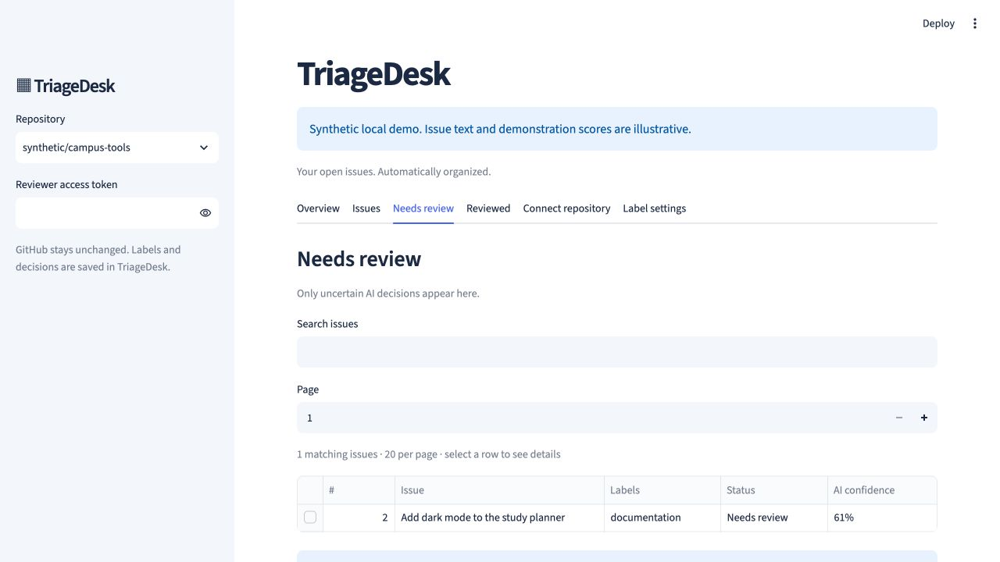

# AI labeling

TriageDesk uses Groq to label imported public GitHub issues. Results and maintainer decisions are stored in PostgreSQL; the app does not write labels back to GitHub.

## Enable automatic labeling

For local development, add your key to the ignored `.env` file:

```dotenv
GROQ_API_KEY=your_groq_api_key
AI_MODEL=qwen/qwen3.8-27b
AI_CONFIDENCE_THRESHOLD=0.85
AI_BATCH_SIZE=5
AI_REQUEST_INTERVAL=10
AUTO_SYNC_SECONDS=60
```

Apply the settings with `docker compose up -d --wait`.

For Streamlit Community Cloud, put the same settings in **App settings → Secrets** using TOML syntax. Keep them at the top level, alongside `DATABASE_URL` and `AUTH_ENCRYPTION_KEY`:

```toml
GROQ_API_KEY = "your_groq_api_key"
AI_MODEL = "qwen/qwen3.8-27b"
AI_CONFIDENCE_THRESHOLD = 0.85
AI_BATCH_SIZE = 5
AI_REQUEST_INTERVAL = 10
AUTO_SYNC_SECONDS = 60
```

Use one quoted, single-line API key. Reload or reboot the app after saving. The cloud entrypoint is `ui/community_app.py`; see [HOSTING.md](HOSTING.md).

Create a key in the [Groq console](https://console.groq.com/keys). The configured model must support [strict structured output](https://console.groq.com/docs/structured-outputs).

## Label groups

| Group | Default labels |
| --- | --- |
| Type | bug, enhancement, documentation, question |
| Priority | priority: high, priority: medium, priority: low, regression |
| Module | billing, onboarding, UI/UX, API |
| Contributor | good first issue, help wanted, easy |
| Workflow | waiting for op's response, dependencies, CI |

Maintainers can customize labels in **Label settings**. A classification selects a primary type and any supported optional labels. The model receives the issue title, a bounded description, source labels, and the configured taxonomy. It does not fetch comment threads or inspect the repository's source code.

The model chooses label IDs and evidence references from supplied options. The backend inserts the corresponding source excerpt into the saved result, so evidence does not depend on the model reproducing a quotation exactly.

## Confidence and review

The effective confidence is the minimum of the overall score and selected label scores. The default cutoff is `0.85`.

- **Auto-sorted:** confidence meets the cutoff and no uncertainty or validation condition requires review.
- **Needs review:** confidence is below the cutoff, the model marks the result uncertain, or the response lacks sufficient supported information.
- **Reviewed:** a maintainer has saved a decision. Human labels take precedence.
- **Waiting for AI:** analysis is pending.
- **AI needs attention:** an attempt failed; the dashboard shows the reason and recovery guidance.

These are model-reported scores, not measured accuracy percentages. A high score does not bypass an explicit uncertainty flag.

Open **Issues** to browse by label group and label. Select a row to inspect the explanation and evidence. Save an uncertain issue's labels in **Needs review** to move it to **Reviewed**.

## Processing and persistence

Initial imports and active-workspace synchronization start small analysis batches. Defaults are five issues per batch, ten seconds between provider requests, and a workspace sync check every sixty seconds. Processing continues while a signed-in workspace is open.

Analyses are cached by snapshot, model, prompt version, and label taxonomy. Unchanged completed results are reused across sign-ins and app restarts. Editing issue content or changing label settings can require fresh analysis.

Saving a human review does not make another AI call. When a closure is detected during GitHub synchronization, the issue and its dependent local history are removed.

## Troubleshooting

| Symptom | What to check |
| --- | --- |
| Key is reported missing | Confirm a top-level `GROQ_API_KEY` in Streamlit Secrets or `.env`, save it, and restart or reload the app. |
| API key rejected | Replace the key in private settings and retry. |
| Model unavailable or request rejected | Check the model name, account access, and support for strict JSON-schema output. |
| Request or token limit reached | Wait for the retry time shown in the dashboard. Increasing batch size cannot bypass provider quotas. |
| Network or provider failure | Keep the workspace open and wait for the scheduled retry. |
| Malformed response | Use **Run AI now** for a fresh attempt, or review the issue manually. Automatic retries are paused for unusable responses. |
| Suggested labels need review | Inspect the uncertainty explanation and supporting text; adjust and save the labels. |

**Run AI now** processes pending analysis without importing GitHub issues or rebuilding search. It reuses completed analyses and respects active jobs and provider backoff. Five eligible reports include approximately forty seconds of deliberate spacing, plus provider and database time.

The dashboard shows progress, failed attempts, and retry times. Provider failure logs use fixed reason codes rather than logging keys or raw provider response bodies.

## Dashboard examples

The following screenshots use synthetic demo issues.





