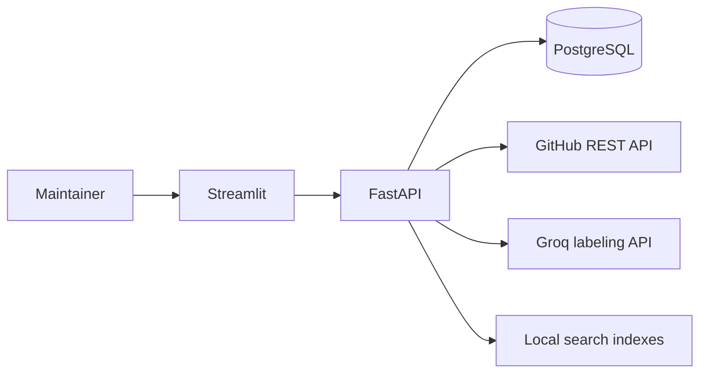

# Architecture

TriageDesk has a Streamlit dashboard, a FastAPI backend, and a PostgreSQL database. The backend reads public GitHub issues and calls Groq to classify them. Labels and maintainer reviews are stored locally in the application database.

## Deployment

Docker Compose runs PostgreSQL, the API, and the UI as separate services. A migration service updates the schema before the API starts.

On Streamlit Community Cloud, `ui/community_app.py` starts one private API process bound to loopback. PostgreSQL runs externally. Supported settings are read from Streamlit Secrets; changing them replaces the private backend with a process using the new configuration. Search indexes use temporary local storage in this deployment.

## Authentication and repository access

A GitHub personal access token or GitHub App device flow establishes the user's identity. Connecting a repository and saving decisions also require verified ownership or a GitHub-reported triage, write, maintain, or admin role.

GitHub credentials are encrypted with the installation's `AUTH_ENCRYPTION_KEY`. Application sessions use expiring bearer tokens; only their hashes are stored in the database. Workspace data is scoped to the signed-in account's connected repositories. The GitHub integration uses read-only permissions.

## Import and synchronization

The connection form starts a bounded background job. Initial workspace imports request recently updated open issues, exclude pull requests, and persist source snapshots. Subsequent synchronization uses update checkpoints and an overlap window so repeated pages can be processed safely.

While a signed-in workspace is open, it polls for updates and starts pending analysis batches. The installation admits one import, indexing, or analysis job at a time. Database leases allow interrupted jobs to be recovered.

When synchronization confirms that an issue is closed, its local issue record and dependent snapshots, analyses, and reviews are deleted. Reopened issues can be imported again. The separate offline import CLI can retain open and closed issues for dataset preparation.

## AI analysis and caching

`ai_labels.py` sends bounded issue text, existing source labels, and the repository's label taxonomy to Groq. GitHub credentials and application session tokens are not included.

The response selects allowed label IDs and numbered source excerpts. The server resolves those references to configured labels and exact source text, then validates the response structure and scores.

The cache key includes the issue snapshot, model, prompt version, and taxonomy. Per-snapshot claims and a unique database constraint prevent duplicate concurrent analyses. Completed results are reused across page refreshes and sign-ins.

A result is auto-sorted only when its effective confidence meets the threshold and it has no uncertainty or validation condition requiring review. Temporary provider failures retain pending work with a retry time. Malformed responses pause automatic retries.

## Reviews and storage

The main tables cover repositories, issues, immutable snapshots, analysis results, label assignments, reviews, application sessions, repository access, and background jobs. Alembic manages schema changes.

A review includes the displayed snapshot, expected revision, and an idempotency key. Conflicting changes return HTTP 409; an identical retry returns the saved result. Human decisions take precedence over AI labels and move issues from **Needs review** to **Reviewed**.

Issue lists and overview counts use filtered SQL queries with bounded pagination rather than loading the entire backlog into the UI.

## Related-issue search and offline models

TF-IDF search is the default. An optional pinned MiniLM encoder provides semantic retrieval when its dependencies and weights are installed. Retrieval stays within the repository and excludes the selected issue and stale index entries.

The repository also contains an offline TF-IDF/logistic-regression classifier and dataset evaluation tools. These are separate from the Groq multi-label workflow. Their recorded results are described in [EVALUATION.md](EVALUATION.md), [MODEL_CARD.md](MODEL_CARD.md), and [DATA_CARD.md](DATA_CARD.md).
