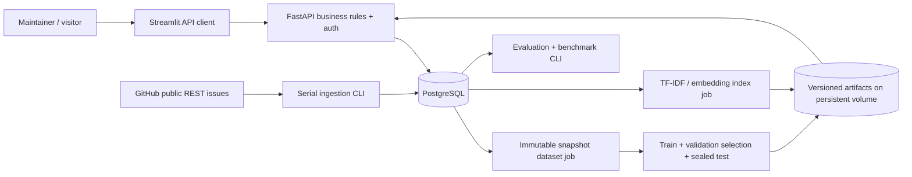

# Architecture

## Boundaries

The interface sends HTTP requests only. FastAPI owns filters, SQL aggregation, reviewer authorization and transaction rules. Jobs run through `triagedesk`; HTTP routes cannot import repositories, train models, choose artifact paths, or fetch arbitrary URLs. One API process and one Streamlit process are enough for this scope.

`repositories` store external identity, partial-import status and UTC checkpoints. `issues` hold current source state and pointers. `snapshots` freeze text/labels/update time; later sync inserts revisions. `predictions` refer to snapshots and model versions. Append-only `reviews` and `similarity_judgments` preserve human decisions. `experiments` register splits, metrics, configuration and artifact locations. `import_runs` record progress/failure counts. Foreign keys, uniqueness and checks live in Alembic revision `0001`. ORM snapshot mutation is rejected.

## Import consistency

Requests are serial; `state=all`, ascending update time, pagination via GitHub Link headers. PR objects are counted and excluded. Each page, its upserts, counts and high-water checkpoint commit in one transaction. A failed page rolls back completely; previous pages remain durable. A ten-minute overlap on `since` makes reruns safe. `since` filters update time, not creation. Checkpoints never go backward. A capped initial import stays marked partial after delta sync. Conditional requests are used for repository metadata; issue pages are deliberately fetched because their query/checkpoint and pagination can change.

The optional connected-GitHub collection used during this build is an attributed bounded REST export, replayed through the same persistence function when anonymous quota was exhausted. It does not claim complete endpoint traversal. Normal users reproduce collection through the direct REST CLI and optional environment token.

## Review consistency

A review includes the displayed snapshot ID, expected review revision and unique submission key. An atomic conditional SQL update increments the revision only if the displayed source and review revision are current. Competing saves return HTTP 409; the UI asks the reviewer to refresh and reconsider. A repeated key and identical payload returns the previous review. A changed payload using that key is rejected. Source updates also increment the revision. Only the latest accept/correct decision on the current snapshot counts as completed. Defer/skip reopen work. Prior decisions remain visible. The configured shared-token identity is an installation identity, not individual nonrepudiation.

## SQL and retrieval

The queue and dashboard share one SQL scope: active data mode, repository, UTC creation interval, source state, literal text search, category source and current review status. Correlated indexed subqueries select the newest prediction and review for the current snapshot. Aggregation runs in SQL, including UTC creation-month buckets. Pagination bounds queue results; charts do not load all issues into Streamlit. Source-label filtering is deliberately omitted; category filters explicitly select model, human, or human-then-model values.

Retrieval computes exact cosine similarity over persisted sparse or normalized dense vectors. It refreshes metadata in ranked batches of at most 100 and excludes self, stale text hashes and unavailable records. Related issue detail routes stay within the source repository. TF-IDF handles full cleaned text; MiniLM sees the first 256 wordpieces. Offline embedding caches are keyed by text hash, pinned model revision and text-policy version. A cache miss at query time never triggers a download. Rebuild after sync to include new/changed text; mark confirmed deleted records unavailable with the private CLI.

## Artifacts and failure behavior

Models live in `ARTIFACT_DIR/models/<version>` with Pipeline, baseline, mapping, frozen split manifest, dependency versions, metrics and card. Training never overwrites a version. `activate` writes an atomic checksum manifest. Serving checks the checksum and exact scikit-learn version and loads only owner-generated local artifacts. Missing/incompatible classifiers yield an explicit unavailable suggestion. Missing semantic weights fall back to clearly labeled TF-IDF. Missing indexes produce an empty unavailable result. Never load downloaded third-party joblib artifacts; checksums detect corruption, not malicious publishers.

## Code map

- `models.py`, `alembic/`: persistence and schema.
- `github.py`, `audit.py`: ingestion and repository checks.
- `dataset.py`, `training.py`, `serving.py`: provenance, supervised learning and serving.
- `retrieval.py`, `retrieval_eval.py`: cached search and frozen judgments.
- `queries.py`, `reviews.py`, `api.py`, `schemas.py`: SQL, consistency, HTTP contract.
- `ui/app.py`: interface; `cli.py`: explicit jobs.

Streamlit simplifies delivery but reruns scripts and limits custom navigation/layout; the API remains independently testable. Exact retrieval and correlated latest-row queries are adequate at this size. Measure before adding an approximate index, read replicas, or asynchronous workers. Kubernetes, Kafka, a vector database, and LLM APIs are deliberately omitted.
